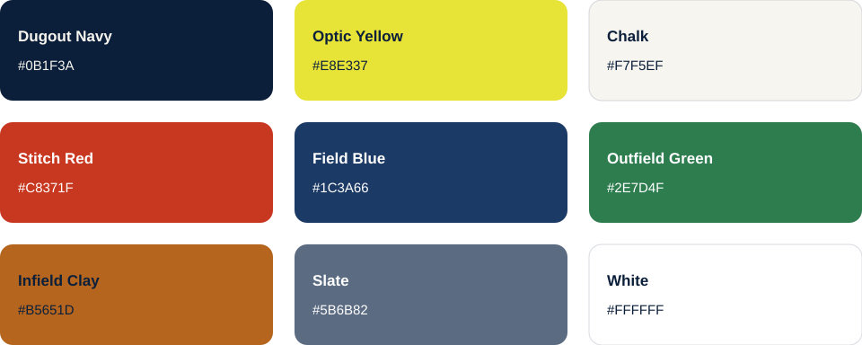
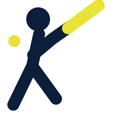
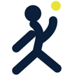
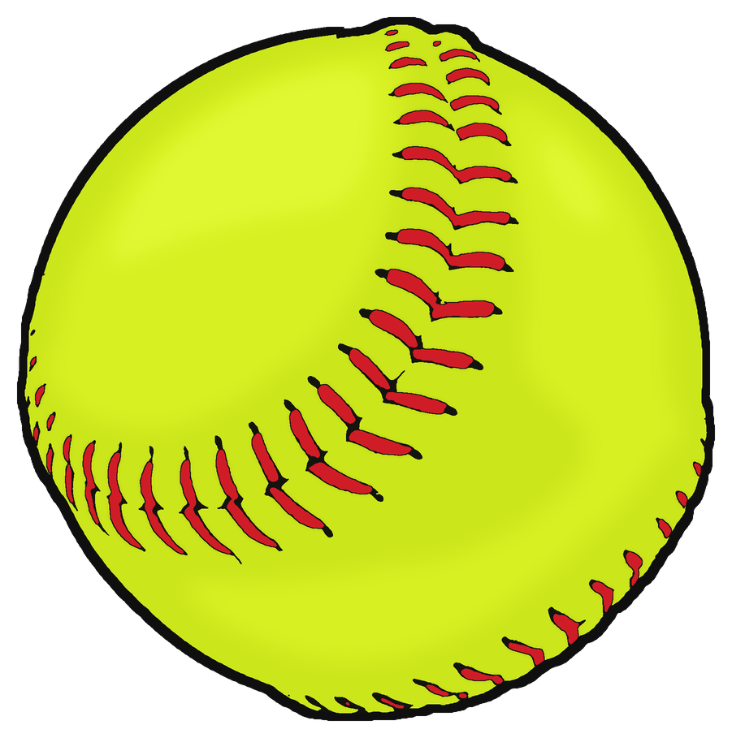

# SportHub Brand Board

A visual quick reference for SportHub's approved marks, color, typography, and softball artwork. For detailed rules see the [usage guidelines](docs/usage-guidelines.md), [asset catalog](docs/asset-catalog.md), [typography and color tokens](docs/typography-and-color.md), and [licensing notes](docs/licensing.md).

**Brand idea:** confident, encouraging, practical coaching support.

**Tagline:** “Coach like you've done this before.”

[Open the interactive-style local preview](preview/index.html) · [Browse all original files](assets/brand/)

## Logo family

| Primary wordmark · light surfaces | Reversed wordmark · dark surfaces |
| --- | --- |
|  |  |

| Softball product lockup | SH app / navigation monogram |
| --- | --- |
|  |  |

Use the SVG originals in `assets/brand/` whenever possible. The reversed wordmark uses **Optic Yellow** for “Hub”; both monogram marks use Optic Yellow for “H.” PNG exports are provided at standard and high-density sizes in [`exports/png/`](exports/png/).

## Palette

| Color | Hex | Role |
| --- | --- | --- |
| Dugout Navy | `#0B1F3A` | Brand anchor, primary text/action, and dark surface |
| Optic Yellow | `#E8E337` | Small highlight and active state; avoid as body text or on Chalk |
| Chalk | `#F7F5EF` | Light surface and text on Navy |
| Stitch Red | `#C8371F` | Softball lockup and destructive/warning semantics |
| Field Blue | `#1C3A66` | Dark-mode cards and hover surfaces |
| Outfield Green | `#2E7D4F` | Success and strengths |
| Infield Clay | `#B5651D` | Opportunities and warm-neutral accents |
| Slate | `#5B6B82` | Secondary text and borders |
| White | `#FFFFFF` | Light cards and reversed marks |

Navy and Chalk should do most of the work. Yellow/Chalk is not a readable text pairing. See the [contrast notes](docs/typography-and-color.md#accessibility-reference-pairs).

## Typography

> **Barlow 800 headline sample:** “Coach like you've done this before.”

- **Barlow 800** — large headlines and wordmarks.
- **Barlow 700** — uppercase labels and short emphasis.
- **Inter variable** — body and UI, typically 400/600.

Fonts are self-hosted under `assets/brand/fonts/`; retain the included OFL license notices. The [preview page](preview/index.html) displays the fonts in context.

## Softball artwork

| Hitting | Pitching | Decorative ball |
| --- | --- | --- |
|  |  |  |

Use only the softball-themed pictograms in the current product. Artwork is supporting decoration, not a replacement for the wordmark.

## Quick use rules

- Keep clear space equal to at least one quarter of a mark's width.
- Minimum display size: 120 px wide for wordmarks; 24 px for the monogram.
- Use the reversed wordmark on Navy/dark backgrounds and the primary wordmark on light surfaces.
- Don’t stretch, recolor, crop, outline, rotate, or add effects to marks.
- Don’t use Optic Yellow for body-copy text or as a large Chalk-background surface.
- The logos and artwork are **not open-licensed**; see [licensing](docs/licensing.md) before external reuse.
